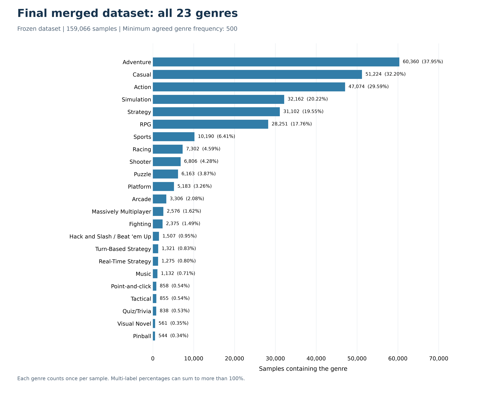

# Final genre distribution

Frozen final dataset: **159,066 samples and 23 genres**. No cleaning or label changes.

| genre | count | percentage | rank |
|---|---|---|---|
| Adventure | 60360 | 37.947 | 1 |
| Casual | 51224 | 32.203 | 2 |
| Action | 47074 | 29.594 | 3 |
| Simulation | 32162 | 20.219 | 4 |
| Strategy | 31102 | 19.553 | 5 |
| RPG | 28251 | 17.761 | 6 |
| Sports | 10190 | 6.406 | 7 |
| Racing | 7302 | 4.591 | 8 |
| Shooter | 6806 | 4.279 | 9 |
| Puzzle | 6163 | 3.874 | 10 |
| Platform | 5183 | 3.258 | 11 |
| Arcade | 3306 | 2.078 | 12 |
| Massively Multiplayer | 2576 | 1.619 | 13 |
| Fighting | 2375 | 1.493 | 14 |
| Hack and Slash / Beat 'em Up | 1507 | 0.947 | 15 |
| Turn-Based Strategy | 1321 | 0.830 | 16 |
| Real-Time Strategy | 1275 | 0.802 | 17 |
| Music | 1132 | 0.712 | 18 |
| Point-and-click | 858 | 0.539 | 19 |
| Tactical | 855 | 0.538 | 20 |
| Quiz/Trivia | 838 | 0.527 | 21 |
| Visual Novel | 561 | 0.353 | 22 |
| Pinball | 544 | 0.342 | 23 |

The most frequent label occurs in 60,360 samples; the least frequent in 544. Their frequency ratio is 110.96.
Percentages use all samples as denominator. Each label counts once per sample; percentages may sum above 100% because this is multi-label classification.

